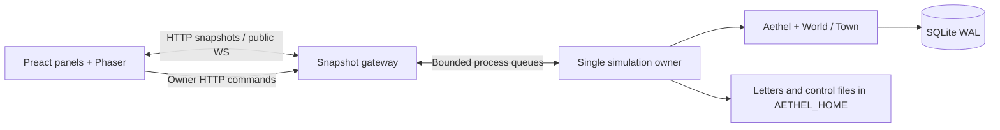

# Architecture and deterministic state

The standard-library simulation is independent of the web stack. `World` is its
only town-facing abstraction. The launcher composes a town and organism; the web
launcher creates exactly one simulation worker process using multiprocessing
`spawn`, avoiding inherited SQLite connections or partially initialized globals.

## Tick and command ownership

Only the worker constructs organisms or opens the process-wide diary store. It
handles owner and journal requests between ticks, persists accepted command IDs,
and stages stable file signals before the next heartbeat. Pending commands have
an indexed SQLite table; old receipts stay on disk rather than growing every
snapshot or rewriting one large JSON record.

An outer store transaction includes the organism heartbeat, both state blobs,
journal rows and applied receipts. Nested store operations defer commits. If a
tick fails, the worker rolls back and exits: continuing with mutated in-memory
objects would break restart fidelity. Stable signal filenames allow uncommitted
commands to recreate their inputs after restart. Do not run a separate headless
organism and the web worker against the same home concurrently.

Snapshots are built only after commit and projected to a bounded public schema.
The gateway stores the newest snapshot under a lock and correlates at most 64
worker requests. HTTP and WS adapters share the projection; frontend rendering
never reads SQLite or arbitrary runtime files. Slow forage can delay a tick but
cannot block serving a previously published snapshot.

## Randomness and schedules

SplitMix64 performs specified unsigned 64-bit arithmetic. Named streams are
derived with stable FNV-1a names, not Python's randomized `hash()`. The organism,
town choices, dreams, foraging and each resident's schedule persist their states.

Resident turns no longer share `tick % 3`. Each schedule draws a Gamma(shape=2,
scale=1.5) wait from two exponential variates, rounds to the nearest whole tick,
and clamps to at least one tick. Quantization slightly shifts the mean from the
continuous three-tick target. Parent visiting counters still count resident
turns. Save both the next scheduled tick and RNG state; loading must not redraw.

Changing resident timing intentionally changes life trajectories in this pre-1.0
release. Existing homes missing schedule fields initialize them deterministically.
The saved root seed wins over new launch defaults, including when a new named
stream is first used after a restart. Restart fidelity remains required under
the new algorithm. Set `PYTHONHASHSEED=0`
when comparing separate interpreter runs with identical scripted world inputs.

## Maintenance boundaries

- `aethel_web/snapshot.py` owns public projections; `gateway.py` owns validation,
  authorization and routing; transport adapters handle HTTP/WS mechanics only.
- Frontend protocol validation rejects malformed snapshots before UI rendering.
  Preact owns controls and panels; Phaser owns the frame loop through a narrow
  snapshot/settings bridge. Loading the game lazily cannot lose a newer snapshot.
- Temperament rates come from Python. Browsing is local UI state; changing nature
  requires an owner command and never bypasses the sleep boundary.
- Explicit offline mode substitutes deterministic reading material; explicit demo
  mode displays an illustrative bundled snapshot. Neither is an outage fallback.
